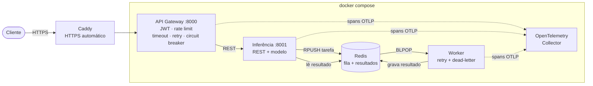

# C3.A2 — Plataforma de IA como Serviço

Sistemas Distribuídos e Computação em Nuvem · FAESA · 2026/2 · Turma 8HC1

## Integrantes

- Arthur Coutinho Chagas
- Enzo Sampaio Lopes Herzog de Azeredo
- Luan Gonçalves dos Santos
- Lucas Machado de Magalhães
- Vinícius de Souza Silva

## Deploy público

**Status: o deploy público não foi concluído.** Tentamos publicar na **Oracle Cloud
(Free Tier, região São Paulo)**, mas a criação da VM falhou por falta de capacidade do
próprio free tier: a Oracle respondeu *"Out of capacity"* tanto para o shape
`VM.Standard.E2.1.Micro` quanto para o `VM.Standard.A1.Flex` (ambos *Always Free*) e, nas
tentativas seguintes, *"Too many requests for the tenant"*.

Deixamos tudo pronto para publicar assim que houver uma VM: HTTPS automático via Caddy
(`docker compose --profile https`), o script `deploy/vm_setup.sh` (um comando) e o passo a
passo em [deploy/INSTRUCOES.md](deploy/INSTRUCOES.md). A plataforma completa sobe
localmente com `docker compose up --build` (veja "Como executar do zero").

## O que é

Plataforma que recebe um texto e devolve uma classificação de sentimento. A IA é só a
carga de trabalho: o foco é a engenharia distribuída — **microsserviços
conteinerizados, orquestrados por um único `docker-compose`, com autenticação,
resiliência, observabilidade e deploy público com HTTPS.**

## Arquitetura



| Serviço | Responsabilidade |
|---|---|
| **gateway** (`gateway/`) | Única porta de entrada: login/JWT, rate limit, validação de entrada, roteamento e proteção das chamadas à inferência |
| **inferencia** (`inferencia/`) | API REST: enfileira tarefas (`POST /predict`) e consulta resultados; carrega o modelo uma vez |
| **worker** (`worker/`) | Consome a fila, roda o modelo, grava o resultado; retentativa com *backoff* e dead-letter |
| **redis** | Fila de tarefas, resultados (com TTL) e dead-letter |
| **otel-collector** | Recebe os traces (OTLP) dos três serviços |
| **caddy** (perfil `https`) | Proxy reverso com certificado Let's Encrypt automático |

Os serviços se encontram pelo **nome** na rede do compose (`inferencia`, `redis`,
`otel-collector`), nunca por IP. Toda configuração vem de **variáveis de ambiente**.

**Fluxo:** `POST /login` → token JWT → `POST /predict` (o gateway valida o token, aplica
o rate limit e chama a inferência; ela enfileira e responde `202 {"id"}`) → o worker
processa → `GET /resultado/{id}` devolve `status: pronto` com o sentimento.

## Como executar do zero (um comando)

Pré-requisito: Docker com Docker Compose.

```bash
git clone https://github.com/ensosampaio/sd-2026-2-kit-c3a2.git
cd sd-2026-2-kit-c3a2
cp .env.example .env          # opcional: sem .env sobe em modo desenvolvimento
docker compose up --build
```

Teste fim a fim (em outro terminal; precisa de `pip install requests`):

```bash
python scripts/smoke_test.py
```

Ou manualmente, sempre pelo gateway:

```bash
TOKEN=$(curl -s -X POST http://localhost:8000/login -H "Content-Type: application/json" \
  -d '{"usuario":"admin","senha":"troque-esta-senha"}' | python -c "import sys,json;print(json.load(sys.stdin)['access_token'])")

curl -X POST http://localhost:8000/predict -H "Authorization: Bearer $TOKEN" \
  -H "Content-Type: application/json" -d '{"texto":"servico excelente"}'
# -> {"id":"..."}

curl http://localhost:8000/resultado/<id> -H "Authorization: Bearer $TOKEN"
# -> {"sentimento":"positivo","status":"pronto",...}
```

(Usuário e senha de desenvolvimento são os do `.env.example`: `admin` / `troque-esta-senha`.)

## Segurança

- **JWT** (HS256, expira em `JWT_EXPIRA_MINUTOS`): todas as rotas, exceto `/login` e
  `/saude`, exigem `Authorization: Bearer`; sem token válido → `401`.
- **Rate limit** por cliente (janela de 60 s): por usuário nas rotas autenticadas e por IP
  no `/login` (proteção contra tentativa de senha). Excedeu → `429` + `Retry-After`.
- **HTTPS** configurado via Caddy (Let's Encrypt automático, `docker compose --profile https`); fica ativo quando a plataforma é publicada numa VM (ver "Deploy público").
- **Segredos fora do código**, em variáveis de ambiente / `.env` (ignorado pelo Git).
  Com `AMBIENTE=production`, o gateway **recusa subir** com segredo < 32 caracteres, senha
  < 12 ou credenciais padrão.
- Entrada validada (1 a 5000 caracteres, não vazia); o Redis **não** é exposto fora da rede
  do compose; erros ao cliente não revelam detalhes internos.

## Resiliência

Chamadas do gateway à inferência (`gateway/app.py`):

| Mecanismo | Comportamento | Configuração |
|---|---|---|
| **Tempo-limite** | Cada chamada expira → `504` | `TIMEOUT_INFERENCIA_SEGUNDOS=5` |
| **Retentativa** | `GET` até 3 tentativas com espera progressiva (0,2 s, 0,4 s). `POST` **não** é retentado (duplicaria tarefas) | `TENTATIVAS_GET=3` |
| **Circuit breaker** | Após 5 falhas seguidas abre e responde `503` na hora; após 20 s testa de novo (meio-aberto) e fecha se voltou | `CB_LIMITE_FALHAS`, `CB_ESPERA_SEGUNDOS` |

No worker: 3 tentativas com *backoff* exponencial e, se esgotar, **dead-letter**
(`tarefas:dead_letter`) mais `status: falha` consultável. Se o Redis cair, a inferência
responde `503` e o worker espera e tenta de novo, sem encerrar. Os contêineres têm
`restart: unless-stopped` e *healthchecks*.

## Observabilidade

Rastreamento distribuído com **OpenTelemetry**, cobrindo **gateway → inferência → fila → worker**
num único *trace*: o gateway injeta o `traceparent` (W3C) na chamada HTTP, a inferência o
grava **dentro da mensagem da fila** e o worker o retoma ao consumir. Spans:
`gateway -> inferencia POST /predict` → `inferencia.enfileirar` → `worker.processar` →
`worker.inferencia`. Para ver os spans (todos com o mesmo `trace_id`):

```bash
docker compose logs otel-collector
```

Cada serviço também registra id, tamanho da entrada e tempo de resposta de cada requisição.

## Conformidade (LGPD)

Projeto acadêmico: **não coletamos nome, e-mail, CPF nem qualquer identificador de
pessoa** — o acesso é uma credencial técnica única, configurada pelo operador.

| Dado | Finalidade | Retenção |
|---|---|---|
| **Texto enviado para análise** (pode, eventualmente, conter dado pessoal digitado pelo usuário) | Executar a classificação de sentimento solicitada | Fica na fila só até ser processado (segundos); o **resultado**, que repete o texto, **expira em 24 h** (`RESULTADO_TTL_SEGUNDOS`) |
| **Resultado** (sentimento, confiança, tempo) | Entregar a resposta ao solicitante | 24 h, depois é apagado automaticamente |
| **Dead-letter** (id da tarefa, tipo do erro, nº de tentativas) | Diagnóstico de falhas | Sem o texto do usuário; só metadados técnicos |
| **IP do cliente** | Rate limit | Só em memória, janela de 60 s; não é gravado |
| **Usuário e senha da API** | Autenticação | Variáveis de ambiente do servidor; nunca em log nem no repositório |
| **Logs** (método, rota, status, id da tarefa, tamanho da entrada, tempos) | Operação e observabilidade | Rotação de 3 × 10 MB por serviço |

Os logs **não** registram o texto do usuário, o token JWT nem a senha (verificado nos testes).
Nenhum dado é compartilhado com terceiros (o modelo roda dentro da própria plataforma).
Para exclusão antecipada de um resultado: `docker compose exec redis redis-cli DEL resultado:<id>`.

## Relatório de trade-offs

CAP, custo e latência: [docs/RELATORIO-TRADEOFFS.md](docs/RELATORIO-TRADEOFFS.md).

## Estrutura

```
├── gateway/        # app.py (JWT, rate limit, resiliência), circuit_breaker.py, telemetry.py, Dockerfile
├── inferencia/     # API REST da inferência, fila Redis, modelo, Dockerfile
├── worker/         # consumidor da fila, retry + dead-letter, Dockerfile
├── scripts/        # smoke_test.py (valida local ou o deploy público)
├── deploy/         # INSTRUCOES.md (VM + HTTPS)
├── docs/           # RELATORIO-TRADEOFFS.md
├── docker-compose.yml, Caddyfile, otel-collector-config.yml
└── .env.example
```

`fila.py`, `telemetry.py` e `log_requisicoes.py` existem em cópias nos serviços que os
usam (cada serviço é uma imagem independente); altere as cópias em conjunto.
